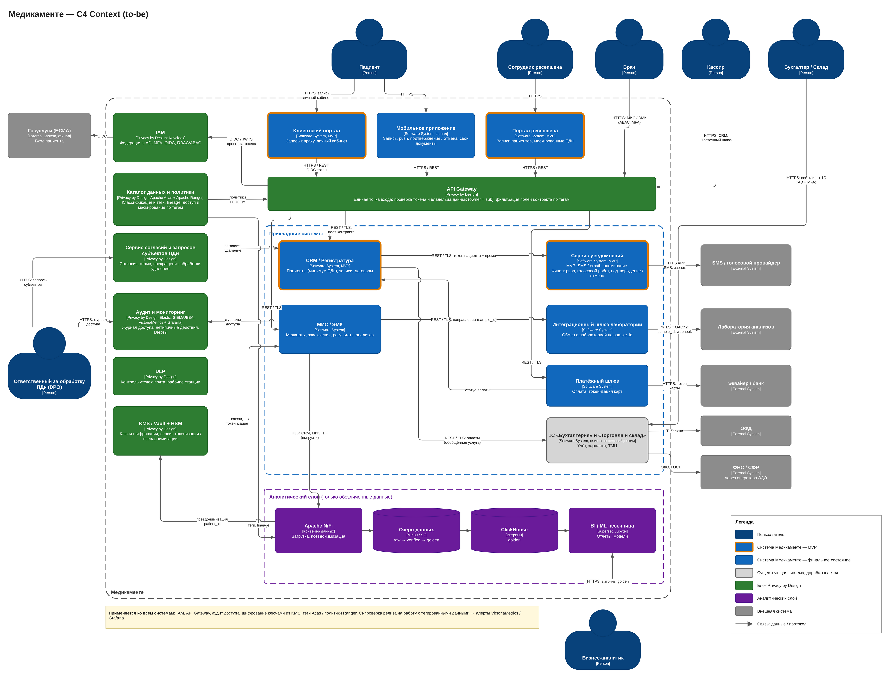

# Задание 2. Проектирование решения

Диаграмма контекста C4 (to-be): [medikamente-c4-context-to-be.drawio](./medikamente-c4-context-to-be.drawio)

## Системы MVP и финального состояния

| Система | Этап | Назначение |
|---|---|---|
| Клиентский портал | MVP | Самостоятельная запись к специалисту |
| Портал ресепшена | MVP | Записи, напоминание пациенту и специалисту за день |
| CRM / Регистратура | MVP | Пациенты (минимальный набор ПДн), расписание, записи, договоры |
| Сервис уведомлений | MVP / финал | В MVP: SMS и email. В финале: push, голосовой робот, подтверждение и отмена |
| МИС / ЭМК | Финал | Медкарты и анализы; пациент видит только свои данные |
| Платёжный шлюз | Финал | Оплата через эквайера, карты токенизированы |
| Интеграционный шлюз лаборатории | Финал | Обмен с лабораторией по API без ПДн |
| Мобильное приложение | Финал | Запись, уведомления, свои анализы, заключения, договор |
| 1С «Бухгалтерия», «Торговля и склад» | Существующие | Перевод в клиент-серверный режим, интеграция по API |

## Блоки Privacy by Design

| Блок | Принцип PbD | Что обеспечивает |
|---|---|---|
| IAM (Keycloak, федерация с AD, MFA) | Privacy Embedded into Design | Единая аутентификация, RBAC для сотрудников, ABAC «лечащий врач» |
| API Gateway | Privacy as the Default | Проверка владельца данных (пациент видит только своё), поля контракта фильтруются по тегам — новым партнёрским интеграциям не нужна перевалидация |
| Сервис согласий и запросов субъектов ПДн | Respect for User Privacy | Согласия (отдельное на медданные), отзыв, прекращение обработки, удаление |
| Каталог данных и тегирование (Apache Atlas) + политики (Apache Ranger) | Visibility and Transparency | Классификация, lineage, доступ и маскирование по тегам, проверка релизов |
| KMS (Vault + HSM), токенизация и псевдонимизация | End-to-End Security | Ключи шифрования at rest, токены вместо идентификаторов во внешних обменах |
| Аудит и мониторинг (Elastic, SIEM/UEBA, VictoriaMetrics + Grafana) | Proactive not Reactive | Журнал доступа, нетипичные действия, алерты о несанкционированном доступе |
| DLP | Proactive not Reactive | Контроль утечек через почту, веб и носители |

## Аналитический слой

Apache NiFi → озеро данных (MinIO) → ClickHouse → BI (Superset) / ML-песочница.

- **NiFi при загрузке:**
  - псевдонимизирует данные: детерминированный `patient_id`;
  - удаляет ФИО и контакты;
  - обобщает дату рождения до возраста.
- **Зоны озера данных:**
  - `raw` — шифрование, доступ только у платформы;
  - `verified` — псевдонимизированные данные;
  - `golden` — витрины.
- **Аналитики, BI и ML** работают только с `golden`. Lineage и теги ведутся в Atlas, доступ задаётся политиками Ranger.
