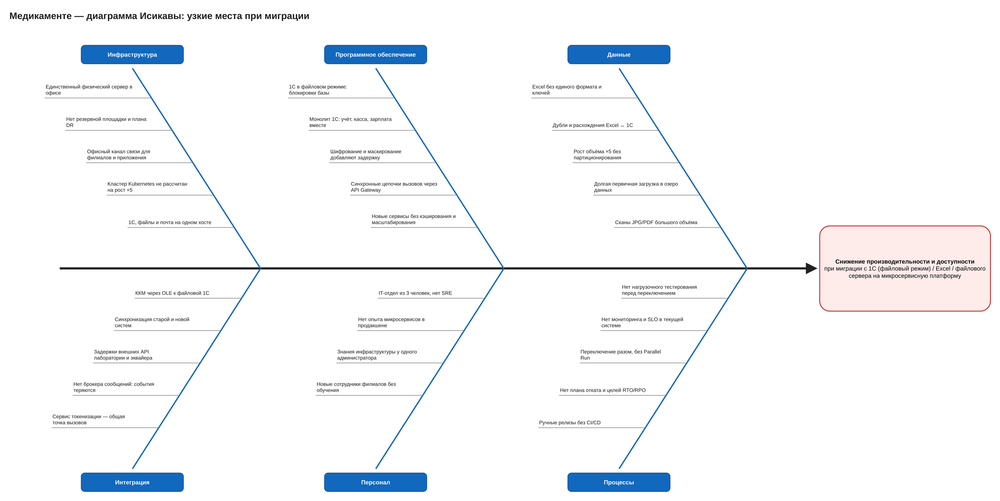

# Задание 4. Оценка узких мест при миграции

Диаграмма Исикавы: [ishikawa.drawio](./ishikawa.drawio)

## Ситуация

- **Откуда.** 1С в файловом режиме, Excel и файловый сервер на одном физическом Windows Server 2022 в офисе, ККМ подключены по OLE.
- **Куда.** Микросервисная платформа из Задания 2: CRM, порталы, МИС, платёжный шлюз, интеграция с лабораторией, блоки защиты данных, озеро данных.
- **Условия.** Рост данных в 5 раз, новые филиалы, мобильное приложение. В IT 3 человека.

Затрагиваемые процессы: запись на приём, приём и медкарта, анализы, оплата, зарплата и склад.

Затрагиваемые компоненты:
- базы и файлы: 1С, Excel, сканы;
- каналы связи: офис, филиалы, интернет;
- серверное оборудование;
- интеграции: ККМ, лаборатория, эквайер, ОФД;
- бизнес-логика записи, оплаты и учёта.

## Выявленные проблемы

| № | Категория | Проблема | Влияние на производительность и доступность |
|---|---|---|---|
| И1 | Инфраструктура | Единственный физический сервер в офисе | Единая точка отказа; при сбое останавливаются все процессы |
| И2 | Инфраструктура | Нет резервной площадки и плана DR | RTO не определён, восстановление может занять дни |
| И3 | Инфраструктура | Офисный канал связи для филиалов и приложения | Узкий канал и задержки для всех внешних пользователей |
| И4 | Инфраструктура | Ёмкость нового кластера Kubernetes не рассчитана под ×5 | Нехватка ресурсов под нагрузкой, вытеснение подов |
| И5 | Инфраструктура | 1С, файлы и почта на одном хосте | Конкуренция за диск и CPU |
| П1 | ПО | 1С в файловом режиме, блокировки базы | Ожидания и таймауты при параллельной работе филиалов |
| П2 | ПО | Монолит 1С: учёт, касса, зарплата вместе | Тяжёлые операции (закрытие месяца) тормозят кассу |
| П3 | ПО | Шифрование и маскирование добавляют задержку | Рост времени ответа на каждом запросе к ПДн |
| П4 | ПО | Синхронные цепочки вызовов через API Gateway | Задержки складываются, отказ одного сервиса каскадно роняет остальные |
| П5 | ПО | Новые сервисы без кэширования и масштабирования | Деградация при пиках записи (утро, понедельник) |
| Д1 | Данные | Excel без единого формата и ключей | Долгая и ошибочная миграция, ручная очистка |
| Д2 | Данные | Дубли и расхождения Excel ↔ 1С | Сверка задерживает переключение, ошибки в отчётах |
| Д3 | Данные | Рост объёма ×5 без партиционирования | Медленные запросы к записям, платежам, аудиту |
| Д4 | Данные | Долгая первичная загрузка в озеро данных | Нагрузка на источники в рабочее время |
| Д5 | Данные | Сканы JPG/PDF большого объёма | Долгий перенос, нагрузка на сеть и хранилище |
| Ин1 | Интеграция | ККМ через OLE к файловой 1С | При переходе 1С в клиент-серверный режим касса отключается |
| Ин2 | Интеграция | Синхронизация старой и новой систем | Двойная запись, задержки и расхождения в переходный период |
| Ин3 | Интеграция | Задержки внешних API лаборатории и эквайера | Блокируют запись и оплату при синхронном вызове |
| Ин4 | Интеграция | Нет брокера сообщений, события теряются | Потерянные уведомления и статусы оплат |
| Ин5 | Интеграция | Сервис токенизации — общая точка вызовов | Узкое место и точка отказа для всех сервисов с ПДн |
| Пс1 | Персонал | IT-отдел из 3 человек, нет SRE | Медленная реакция на инциденты |
| Пс2 | Персонал | Нет опыта микросервисов в продакшене | Ошибки конфигурации и неоптимальные решения |
| Пс3 | Персонал | Знания инфраструктуры у одного администратора | Bus factor = 1 |
| Пс4 | Персонал | Новые сотрудники филиалов без обучения | Ошибки ввода, обходные пути (Excel) |
| Пр1 | Процессы | Нет нагрузочного тестирования перед переключением | Проблемы производительности обнаруживаются в проде |
| Пр2 | Процессы | Нет мониторинга и SLO в текущей системе | Нет базы для сравнения «до/после» |
| Пр3 | Процессы | Переключение разом, без Parallel Run | Нельзя сравнить результаты и откатиться |
| Пр4 | Процессы | Нет плана отката и целей RTO/RPO | Долгий простой при неудачном релизе |
| Пр5 | Процессы | Ручные релизы без CI/CD | Редкие рискованные релизы, долгий Lead Time |

## Рекомендации и приоритет

Приоритет:
- **Высокий** — блокирует миграцию или даёт простой всей системы;
- **Средний** — деградация под нагрузкой;
- **Низкий** — улучшение эффективности.

| Мера | Устраняет | Приоритет |
|---|---|---|
| Перенести платформу в ЦОД или облако РФ: 2 зоны, резервирование, бэкапы вне офиса; задать RTO/RPO и проверить восстановление | И1, И2, И5, Пр4 | Высокий |
| Ввести мониторинг и SLO до миграции (VictoriaMetrics + Grafana, Elastic) и снять базовые метрики: время записи, оплаты, ответа 1С | Пр2 | Высокий |
| Перевести 1С в клиент-серверный режим на PostgreSQL; ККМ подключить через драйвер ККТ / API вместо OLE, протестировать кассу до переключения | П1, П2, Ин1 | Высокий |
| Переключение по Strangler Fig и Branch by Abstraction: запись → оплата → медкарты → лаборатория; Parallel Run со сверкой результатов, поэтапный трафик 10% → 50% → 100% по feature toggles | Пр3, Ин2 | Высокий |
| Нагрузочное тестирование на профиле ×5 перед каждым этапом; план отката для каждого этапа | Пр1, Пр4, И4 | Высокий |
| Очистка и дедупликация Excel до миграции, единые ключи пациентов, сверка Excel ↔ 1С; затем отказ от Excel-учёта | Д1, Д2 | Высокий |
| Нанять SRE / DevOps-инженера, документировать инфраструктуру (runbook), дежурства | Пс1, Пс3 | Высокий |
| Асинхронные интеграции через брокер (Kafka) с повторной доставкой; таймауты и circuit breaker на вызовах лаборатории и эквайера | П4, Ин3, Ин4 | Средний |
| Горизонтальное масштабирование сервисов (HPA), кэш расписания и справочников, расчёт ёмкости кластера под ×5 | П5, И4 | Средний |
| Партиционирование таблиц записей, платежей и аудита по дате, индексы под основные запросы | Д3 | Средний |
| Шифрование: envelope encryption с кэшированием ключей данных, полевое шифрование только тегированных полей; токенизацию масштабировать на несколько реплик | П3, Ин5 | Средний |
| Выделенный канал или VPN-концентратор для филиалов, приложение публикуется из ЦОД, а не из офиса | И3 | Средний |
| Обучить команду: микросервисы, Kubernetes, практики безопасности; привлечь внешнюю экспертизу на первые этапы | Пс2 | Средний |
| CI/CD с автотестами и проверкой тегов данных (Задание 1) | Пр5 | Средний |
| Первичная загрузка в озеро данных и перенос сканов — инкрементально, вне рабочего времени, с ограничением скорости | Д4, Д5 | Низкий |
| Обучить сотрудников филиалов работе с новыми порталами до запуска; запретить параллельный учёт в Excel | Пс4 | Низкий |

Метрики контроля: время записи на приём (p95), время оплаты, доступность (SLO 99.9%), MTTR, Deployment Frequency, Lead Time for Changes, RTO/RPO.
